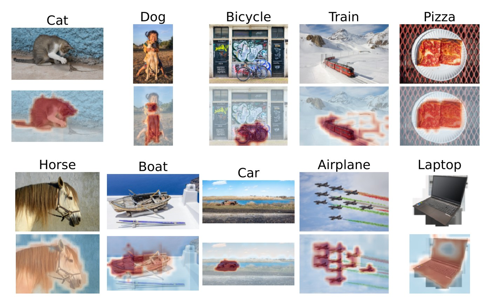

# CAPTOR

**Text-encoder-free grounding by counting caption co-occurrence over the visual words of a frozen encoder**

Elad Yoshai and Natan T. Shaked, Tel Aviv University

[Paper (arXiv)](https://arxiv.org/abs/TODO) · [Project page](https://eladyoshai.github.io/captor/) · [Demo](https://huggingface.co/spaces/EladY/captor-demo) · [Pretrained tables](https://huggingface.co/EladY/captor)

Grounding a text query in an image needs a matrix that scores every term against
every patch. Vision-language models compute it with an aligned text encoder, which
many image encoders, such as pathology models trained on slides alone, do not have.
CAPTOR (Caption-Anchored Patch-Term Occurrence Representation) estimates the matrix
without a text encoder. It clusters a frozen image encoder's patch tokens into
visual words and describes each captioned image by the share of its patches in each
word. A term's signature is the standardized difference of those shares between
images whose captions mention the term and the rest. The matrix then factorizes as
`A = S Ψ`, a term-by-word table `S` times a query-independent image factor `Ψ`, so
an image is encoded once and a new term adds one row to the table. No gradient training
and no text encoder are used; segmentation labels only choose a few settings on
development data.



<sub>Photographs from Wikimedia Commons: "cat", "dog" and "bicycle" by Basile Morin, "train" by Kabelleger and David Gubler, "pizza" and "car" by Rhododendrites, "horse" by Alvesgaspar, "boat" by Norbert Nagel, "airplane" by Carlos Delgado, all CC BY-SA 3.0 or 4.0, and "laptop" by PantheraLeo1359531, CC BY 4.0.</sub>

## Install

```bash
git clone https://github.com/EladYoshai/captor.git
cd captor
pip install -e .                     # natural images (DINOv2)
pip install -e ".[pathology]"        # adds UNI and Phikon-v2 (timm, transformers)
pip install git+https://github.com/Mahmoodlab/CONCH.git   # adds CONCH
```

Python 3.9 or newer and PyTorch 2.1 or newer. Everything runs on the CPU; pass
`device="cuda"` to use a GPU for the encoder.

CONCH and UNI are gated on the Hugging Face Hub. Request access on
[MahmoodLab/CONCH](https://huggingface.co/MahmoodLab/CONCH) and
[MahmoodLab/UNI](https://huggingface.co/MahmoodLab/UNI), then run
`huggingface-cli login`. DINOv2 and Phikon-v2 download without registration.

## Quick start

Natural images (DINOv2 ViT-B/14 with registers and the COCO caption table):

```python
from captor import CAPTOR

model = CAPTOR.from_pretrained("coco_dinov2reg_k640")      # downloads the table once
seg = model.segment("examples/images/cat_lizard.jpg", ["cat", "dog", "bird", "bench"])
print(seg.shares())          # share of the image named by each term
seg.labels                   # (14, 14) index of the term at each patch
seg.scores                   # (14, 14, T) score of every term at every patch
model.score("examples/images/cat_lizard.jpg", ["cat", "dog"])   # whole-image ranking
```

Pathology (CONCH image encoder and the PathCap caption table):

```python
from captor import CAPTOR

model = CAPTOR.from_pretrained("pathcap_conch_k80")
seg = model.segment("examples/images/bcss_TCGA-GM-A2DF_x896_y1792.jpg",
                    ["tumor", "stroma", "lymphocyte", "necrosis", "adipose"])
seg.labels                   # (28, 28) grid on CONCH
```

The same code reads UNI and Phikon-v2, encoders with no text tower of their own:
build a table for them from PathCap captions with `scripts/build_table.py`
(`--encoder uni` or `--encoder phikon_v2`, `--preset pathology`).

From the command line, `segment.py` saves the image, its label map and, with
`--maps`, one score map per term:

```bash
python scripts/segment.py --table coco_dinov2reg_k640 --image examples/images/pizza.jpg \
    --terms "pizza,dining table,cup,fork" --maps
```

`examples/natural_images.ipynb` and `examples/pathology.ipynb` (and the equivalent
`.py` scripts) run end to end on the bundled images. `demo/app.py` is a small
Gradio app with both domains (`pip install gradio && python demo/app.py`).

## Pretrained tables

| name | encoder | K × vocabularies | caption corpus | terms | size | in this repo |
|---|---|---|---|---|---|---|
| `coco_dinov2reg_k640` | DINOv2 ViT-B/14 with registers, 196 px | 640 × 4, joint words | COCO train2017, 15,000 images | 78 objects | 66.6 MB | Hub only |
| `pathcap_conch_k80` | CONCH image trunk, 448 px | 80 × 4 | PathCap, 32,463 figures | 25 tissue terms | 1.0 MB | yes |

`CAPTOR.from_pretrained(name)` looks for the file in the directory named by the
`CAPTOR_TABLES` environment variable, then in `pretrained/`, and otherwise
downloads it from the Hugging Face model repository
[EladY/captor](https://huggingface.co/EladY/captor). Any `.npz` path works too.
`pretrained/MANIFEST.json` lists every table's settings, size and SHA-256.

The COCO table uses the reported natural-image configuration: soft assignment over
the 16 nearest words (sharpness 10), joint words with trust weight `n / (n + 3)`,
one round of caption-conditioned recounting, signatures divided by their own
permutation null (95th percentile of 200 shuffles), phrase-aware caption matching
with full names required for eight terms, and propagation along the encoder's patch
affinity. The pathology tables use the pathology configuration: hard assignment,
four vocabularies averaged, no null division, propagation. The 25 pathology terms
are tumor, stroma, lymphocyte, necrosis, adipose, nuclei, nuclear, carcinoma,
lymphoid, gland, glandular, muscle, vessel, vascular, fibrosis, fibrous,
epithelium, epithelial, mitosis, mitotic, cytoplasm, inflammatory, hemorrhage,
keratin and mucin.

A table is one `.npz` file read with `numpy.load` (no pickle); the keys are
documented in `captor/io.py`.

## Building a table from your own captions

A table needs a folder of images and one or more captions per image:

```bash
# captions.json: {"img_0001.jpg": "a dog on a beach", "img_0002.jpg": ["...", "..."], ...}
python scripts/build_table.py --images my_corpus/ --captions captions.json \
    --terms dog,cat,beach,boat --preset natural --out my_table.npz
python scripts/segment.py --table my_table.npz --image photo.jpg --terms dog,beach
```

`--preset natural` and `--preset pathology` set every constant to the paper's value
for that domain (K, vocabularies, matching rule, null scaling, joint words,
recounting, read-out); individual flags override them, and `--tokens corpus.npy`
keeps the encoded corpus so a second build skips the encoder. In Python:

```python
from captor import BuildConfig, Corpus, build_table, CAPTOR
from captor.encoders import load_encoder

enc = load_encoder("dinov2_reg")
corpus = Corpus.encode(image_paths, captions, enc)        # captions lower-cased
table = build_table(corpus, ["dog", "cat", "beach"], "dinov2_reg",
                    BuildConfig.preset("natural"))
model = CAPTOR(table, enc)
model.add_terms(["surfboard"], corpus)                    # one more row
```

A term is counted only if enough corpus images name it (25 on natural images, 100
in pathology) and, on natural images, if its strongest word beats the term's own
permutation null; terms that do not are reported and left out. For natural images
each term is named by itself, its plural and, for a compound such as "dining table",
its last word, unless a `--forms` file gives other surface forms. The COCO table
stores the WordNet-derived surface forms it was counted with, and `add_terms` reuses
them so that a longer name still consumes the words inside it.

## Reproducing the paper's numbers

**COCO** (78-way grid mIoU on the reporting half of the first 5,000 val2017 images;
needs `pip install pycocotools`):

```bash
python scripts/eval_coco.py --coco-root /data/coco --tokens coco_val_tokens.npy
# test: 2500 images, 162215 labelled cells
# mIoU 0.5654  accuracy 0.7681
```

`--coco-root` holds `val2017/` and `annotations/instances_val2017.json`. The first
run encodes the 5,000 images (and caches the tokens with `--tokens`); later runs
take about two minutes on a CPU.

**BCSS** (five tissues, 200 fields of 896 × 896 pixels, 62 held-out patients;
needs CONCH):

```bash
python scripts/eval_bcss.py --bcss-root /data/bcss --tokens bcss_conch_tokens.npy
# test: 134 fields from 62 patients, 101783 labelled cells
# mIoU 0.4966  accuracy 0.7310
python scripts/eval_bcss.py --bcss-root /data/bcss --tokens bcss_conch_tokens.npy --split dev
# dev: 66 fields from 41 patients -> mIoU 0.4521 (where K = 80 was chosen)
```

`--bcss-root` is the BCSS release at 0.25 microns per pixel
(`rgbs_colorNormalized/`, `masks/`, `meta/gtruth_codes.tsv`).

**Tests.** `pytest` runs the unit tests on synthetic data. The parity tests in
`tests/test_parity.py` reproduce both headline numbers from cached features and are
skipped unless the cache paths are given:

```bash
CAPTOR_COCO_EVAL_DIR=cache/coco   # eval_tokens.npy and truth.npy
CAPTOR_BCSS_ROOT=/data/bcss CAPTOR_BCSS_TOKENS=bcss_conch_tokens.npy \
    pytest tests/test_parity.py
```

The COCO table reproduces the reference predictions exactly, on all 326,390
labelled cells of the 5,000 evaluation images. Rebuilding a table with
`build_table.py` gives a table of the same construction but not a bit-identical
one: k-means initialisation and the permutation nulls are seeded, but PyTorch and
NumPy draw from different random streams on different devices, so the visual words
and the null scales differ from one machine to another. Counted from the same
15,000 COCO captions on a CPU, the rebuilt table scored 0.567 mIoU with the
released vocabularies and 0.555 with freshly fitted ones.

## Citation

```bibtex
@article{yoshai2026captor,
  title   = {{CAPTOR}: Text-Encoder-Free Grounding by Counting Caption Co-occurrence
             over the Visual Words of a Frozen Encoder},
  author  = {Yoshai, Elad and Shaked, Natan T.},
  journal = {arXiv preprint arXiv:TODO},
  year    = {2026}
}
```

## License

The code is released under the [MIT License](LICENSE).

The pretrained tables are statistics counted from caption corpora and computed
from frozen encoders' features; they carry no images. Use them under the terms of
their sources:

- `coco_dinov2reg_k640` is counted from COCO captions (COCO annotations,
  [CC BY 4.0](https://cocodataset.org/#termsofuse)) over DINOv2 features (DINOv2
  code and weights, Apache 2.0).
- The `pathcap_conch_k80` table is counted from PathCap captions (distributed with
  PathAsst, Sun et al. 2023, [CC BY-NC 2.0](https://huggingface.co/datasets/jamessyx/PathCap)),
  so it is for non-commercial use.
- Encoder weights are not distributed here and follow their own licences.
  [CONCH](https://huggingface.co/MahmoodLab/CONCH) and
  [UNI](https://huggingface.co/MahmoodLab/UNI) are CC BY-NC-ND 4.0, gated, for
  non-commercial academic research by registered users;
  [Phikon-v2](https://huggingface.co/owkin/phikon-v2) is under the Owkin
  non-commercial licence. The pathology table is computed from CONCH features and is to
  be used under the same non-commercial terms.

The example images in `examples/images/` are redistributed under their own
licences (CC BY-SA 4.0 photographs from Wikimedia Commons and CC BY 4.0 fields
from BCSS); see `examples/images/CREDITS.md`.
